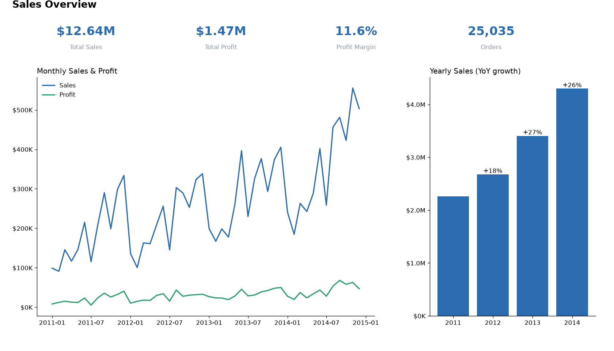
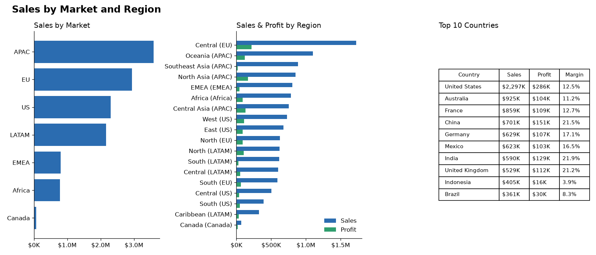
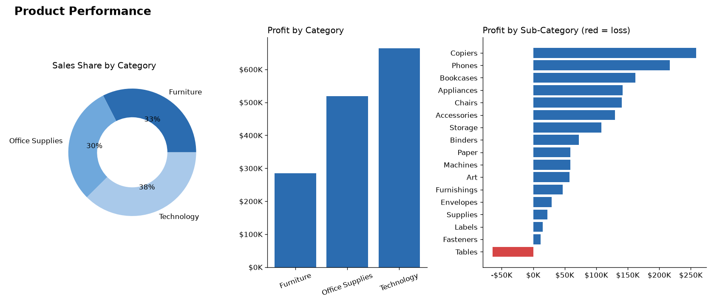
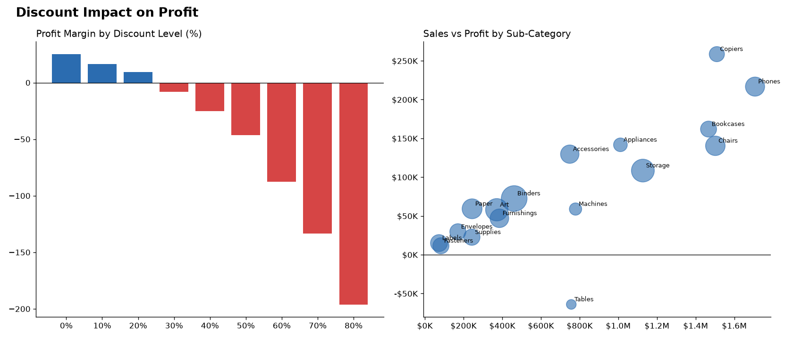

# Sales Analytics Dashboard

Data cleaned with **Python and Pandas** and visualized with **matplotlib** dashboard pages (a Power BI build guide is also included), to analyze 50,000+ sales transactions and support inventory decisions.

## Run it

1. Download the data from https://www.kaggle.com/datasets/apoorvaappz/global-super-store-dataset and save it as `data/Global_Superstore2.csv` (the `data/` folder is in the repo but the CSV files are not uploaded).
2. Clean it:
```bash
pip install -r requirements.txt
python clean_data.py      # creates data/clean_sales.csv
python make_charts.py     # creates the images in results/
```
3. (Optional) Follow **[POWERBI_GUIDE.md](POWERBI_GUIDE.md)** to rebuild the dashboard in Power BI Desktop.

## Project files

| File | What it does |
|---|---|
| `clean_data.py` | Reads the raw CSV (Latin-1), removes duplicates, trims text, parses day-first dates, drops invalid rows, adds Year / Month / Profit Margin / Ship Days columns (51,290 rows, 2011–2014) |
| `make_charts.py` | Creates the four dashboard-page images in `results/` |
| `results/` | Dashboard page images |
| `POWERBI_GUIDE.md` | Optional step-by-step Power BI build: data load, DAX measures, 4 report pages |

## Dashboard Results

Dashboard pages generated from `data/clean_sales.csv` by `make_charts.py` (matplotlib), saved in the [`results/`](results) folder. They mirror the four report pages in the optional Power BI guide.

### 1. Overview


### 2. Regions


### 3. Products


### 4. Discount Impact


## Findings
- **APAC** and **EU** are the top markets by sales; Canada is the smallest.
- **Technology** is the most profitable category, Furniture the weakest.
- **Tables** lose money overall (about -$64K).
- Discounts of 30% or more turn orders unprofitable; 0–20% discounts earn about $2.3M profit combined.

## Resume line
Built a sales analytics dashboard using Python (Pandas, matplotlib) to analyze 50,000+ transaction records; identified top-performing regions and product categories, enabling data-driven inventory decisions.
